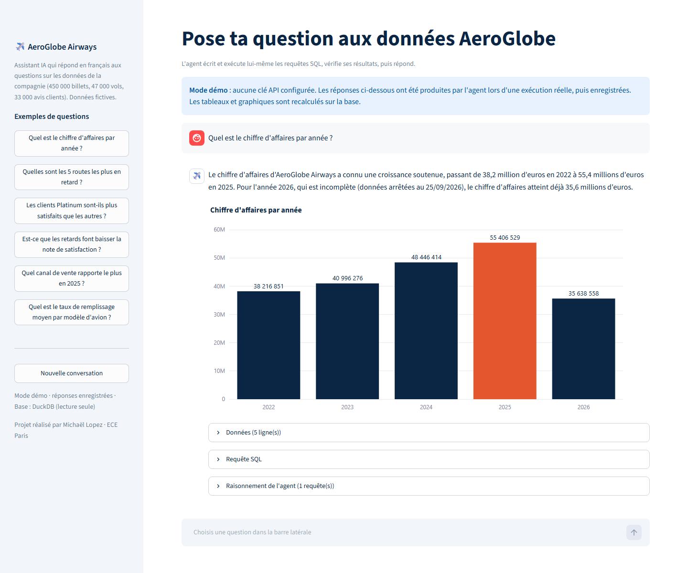
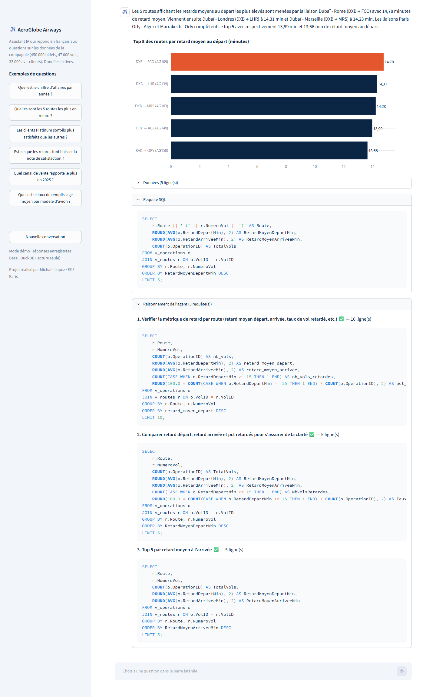

# ✈️ AeroGlobe · Assistant data en langage naturel

Pose une question en français sur les données d'une compagnie aérienne, l'agent IA écrit lui-même les requêtes SQL, les exécute, vérifie ses résultats et te répond avec un chiffre, un graphique et la requête utilisée.

> « Quelles sont les 5 routes les plus en retard ? »
> « Les clients Platinum sont-ils plus satisfaits que les autres ? »
> « Quel canal de vente rapporte le plus en 2025 ? »



Ce projet prolonge mon rapport Power BI **AeroGlobe** (modèle en étoile, 3 tables de faits, 45 mesures DAX) : même jeu de données, mais cette fois l'utilisateur n'a pas besoin de connaître Power BI ou SQL pour obtenir une réponse.

## Ce qu'il fait

- **Agent texte → SQL** : le modèle d'IA dispose d'un outil `run_sql`. Il explore les tables, lance ses requêtes, lit les erreurs et se corrige avant de conclure.
- **Deux fournisseurs interchangeables** : Google Gemini (offre gratuite) ou Claude (Anthropic), choisis automatiquement selon la clé présente dans `.env`.
- **Réponse structurée** : une phrase de synthèse, la requête finale, le tableau de résultats et un graphique Plotly choisi selon la question.
- **Transparence** : chaque requête testée par l'agent est visible dans l'onglet « Raisonnement de l'agent ».
- **Conversation** : on peut enchaîner les questions (« et pour 2024 ? »).
- **Mode démo** : chaque réponse réussie est enregistrée. Sans clé API, l'appli rejoue ces réponses (signalé à l'écran), en recalculant tableaux et graphiques sur la base.

## Exemple : l'agent se corrige tout seul

Pour « Quelles sont les 5 routes les plus en retard ? », l'agent compare plusieurs façons de mesurer le retard avant de répondre, et chaque requête est visible :



## Données

Jeu synthétique AeroGlobe Airways (01/2022 → 09/2026) chargé dans **DuckDB** :

| Table | Contenu | Lignes |
|---|---|---|
| `fait_ventes` | billets vendus | 450 000 |
| `fait_operations` | vols opérés (statut, horaires, remplissage) | 46 930 |
| `fait_satisfaction` | avis et réclamations clients | 33 057 |
| `dim_*` | dates, clients, aéroports, avions, vols, classes, canaux | — |
| `v_routes`, `v_operations` | vues métier : routes lisibles (`CDG → JFK`), retards en minutes, taux de remplissage | — |

## Sécurité

L'agent ne peut que lire :
- une seule requête `SELECT` / `WITH` par appel, les instructions d'écriture et les fonctions d'accès aux fichiers sont refusées ;
- la base est chargée en mémoire, puis l'accès aux fichiers externes est coupé dans DuckDB ;
- chaque requête est limitée à 1 000 lignes et 20 secondes.

## Lancer le projet

```bash
python -m venv .venv
.venv\Scripts\activate          # Windows (macOS/Linux : source .venv/bin/activate)
pip install -r requirements.txt
copy .env.example .env          # puis colle ta clé GEMINI_API_KEY (gratuite) ou ANTHROPIC_API_KEY
streamlit run app.py
```

Les CSV de `data/raw/` sont convertis automatiquement en Parquet au premier lancement.

Sans clé, l'appli démarre en **mode démo** sur les réponses enregistrées dans `data/demo/reponses.json`. Paramètres d'URL utiles : `?demo=1` (forcer le mode démo), `?q=ta question` (poser une question au chargement), `?details=1` (déplier SQL et raisonnement).

Pour régénérer les réponses de démo avec le vrai modèle : `python scripts/run_examples.py`.

## Tests

```bash
pytest
```

Les tests vérifient la couche données (volumes, calcul des retards, garde-fou SQL), la boucle de l'agent pour Gemini et Claude avec de faux clients, et le mode démo, sans aucun appel à une API.

## Stack

Python · Streamlit · DuckDB · Pandas · Plotly · API Gemini (Google) et API Claude (Anthropic) avec appel d'outils

## Structure

```
app.py                 interface Streamlit
assistant/db.py        chargement DuckDB, vues métier, garde-fou SQL
assistant/agent.py     boucle agent Gemini / Claude (outil run_sql + réponse structurée)
assistant/demo.py      enregistrement et rejeu des réponses (mode démo)
assistant/charts.py    graphiques Plotly
tests/                 tests unitaires (pytest)
data/raw/              jeu de données AeroGlobe (CSV)
```

---

Projet réalisé par **Michaël Lopez**, élève ingénieur Data & IA à l'ECE Paris.
[LinkedIn](https://www.linkedin.com/in/michael-lopez-data/)
